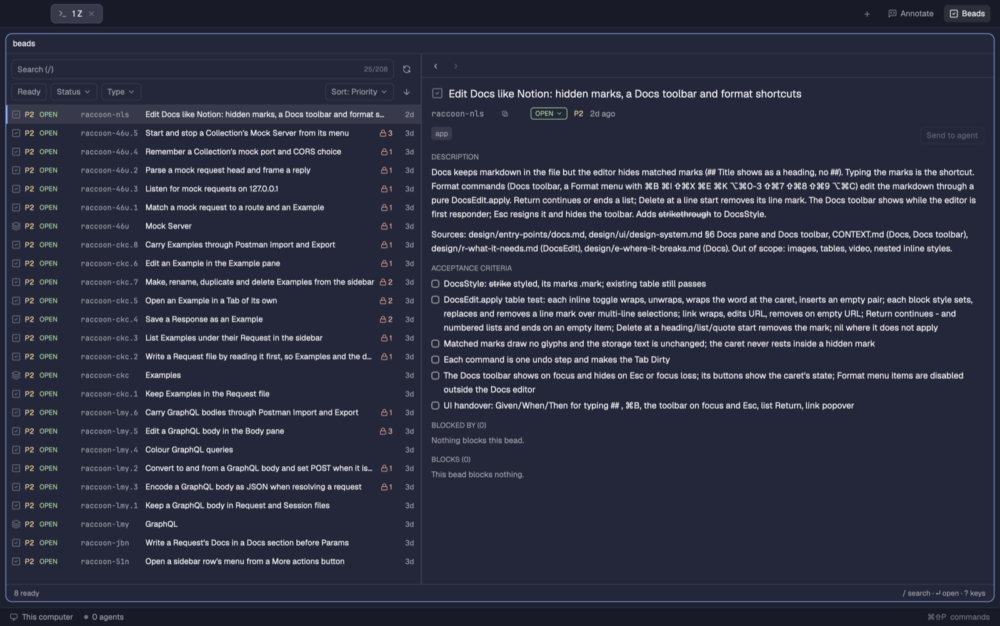

# Beads

This recipe covers the beads mod: `mods/beads/`, `keys.json` and `preview.png`. The Paddock layout in this folder
(`layouts/paddock.*`, `mods/paddock-*/`) is separate and installs by copying; see the
[README](https://github.com/derangga/herdr-mods#paddock).

A pane that lists the beads of a repo beside the terminal or agent working on it. You filter, sort and search the
list, read a bead, follow its dependencies, change its status, and send its id to an agent. It reads and writes
beads only through the `bd` command.

## What you see

A header row with a search box (`Search (/)`, the shown count `25/208` on its right) and a refresh icon. Under it
the filters `Ready`, `Status ▾`, `Type ▾`, and on the right `Sort: Priority ▾` with a direction arrow. Below that
the list and a footer such as `8 ready` with the hints `/ search · ↵ open · ? keys`.

The pane measures its own width. At 800 px or more it is wide: the list takes 42% of the width (at least 360 px)
and the detail the rest. Below 800 px it is narrow: the list fills the pane, `↵` or a click opens the detail, and
`‹ List` or `Esc` goes back.

Each list row is 28 px: type icon, priority (`P0` red, `P1` peach, `P2` yellow, `P3` blue, `P4` muted), status
(`OPEN` green, `IN PROGRESS` blue, `BLOCKED` red, `DEFERRED` muted), id in the monospace font and muted, title
(truncated), age on the right. A bead with open blockers shows a lock and the count after its title. A closed bead is
drawn all in muted. The selected row has a `surface0` background and a 2 px accent bar on its left edge. Colors come
from `theme()`, so the pane follows the user's theme.

The detail shows, top to bottom: `‹ ›` history arrows, type icon, title (16 px, semibold); id with a copy icon,
status pill, priority, assignee, age; label chips and a `Send to agent` button; then Description, Design,
Acceptance criteria and Notes when they have text (11 px uppercase muted headings, markdown bodies); `Blocked by (n)`
and `Blocks (n)` as dependency trees; and Comments, oldest first.

## How it behaves

- Keys, with the pane focused: `j` `k` or `↓` `↑` move the selection; `↵` opens the detail when narrow; `Esc`
  closes the nearest menu, then the search box, then the detail; `/` focuses search; `[` `]` go back and forward
  through followed beads; `s` opens the status picker; `y` copies the id; `Ctrl+R` refreshes; `?` shows the keys.
- Clicking an id in a dependency tree shows that bead. A bead already shown higher in a tree is dimmed and not
  expanded again.
- The status picker fades in over 120 ms. Picking a status runs `bd update <id> --status <status>`. The pill
  spins and dims to 0.6 while it runs. A failure puts the old status back and shows bd's error under the meta row.
- `Send to agent` copies the id to the clipboard, focuses the agent's pane, and pastes. It does not press Enter. The
  button says `Sent to claude` for 1.2 s. With no agent in the tab it is dimmed and its hover says `No agent in this tab`.
- Nothing else animates: selection, detail swaps and hover change instantly. A first load shows a spinner and
  `Loading beads` only after 150 ms.
- States: no `.beads` in the repo shows `No beads database in <folder>` and the `bd init` hint. `bd` missing or
  failing shows bd's text in red with a Retry button and keeps the last good list. A repo on another machine shows
  `Remote spaces aren't supported yet`.
- Keybinding: `keys.json` adds `cmd-shift-b`, which splits a Beads pane to the right of the focused terminal.

## Built from

- One mod named `beads`, `mod.json` `{ "place": "none", "focusable": true }`, `main.js` (an esbuild bundle that
  leaves `gpui-kit`, `gpui-base` and `herdr` external), and `icons/*.svg`.
- Three copies of the mod, told apart by `props().role`: the Viewer (no role), a tab-bar button (`toggle`) and a keys
  dialog (`keys`, opened with `openOverlay` as a 460 x 320 dialog). The button is optional and needs a layout block.
- `herdr` functions: `exec`, `focused`, `panes`, `agents`, `spaces`, `props`, `settings`, `theme`, `nextCommand`,
  `openOverlay`, `closeOverlay`, `run`. Commands run: `pane.split`, `pane.close`, `pane.focus`, `terminal.paste`.
- Programs run with `exec`, in the repo of the focused terminal, with a 15 s timeout: `bd --version`, `bd export`,
  `bd ready -n 0 --json`, `bd blocked --json`, `bd statuses --json`, and `bd update <id> --status <status>`. A locked
  database is retried after 300 ms and 900 ms.
- One `bd export` reads every bead with its detail, and the pane then shows beads and their dependency trees without
  running `bd` again. The list is a virtual list.
- No network. It reads no file outside its own folder; `bd` reads the repo's `.beads` data.

## Watch out

- Needs herdr-app 0.1.15 or later and `bd` on the PATH. It was tested with `bd` 1.3.4. Another version may print output the pane
  does not understand. It then shows the error with bd's version.
- It polls `panes()` every 500 ms for the button and every 200 ms for keyboard focus, because `herdr.d.ts` does not
  say a mod redraws when panes change.
- Send to agent relies on `pane.focus` landing about 100 ms after `run()` returns, then `terminal.paste`. It
  restores the previous clipboard text after 300 ms.
- A layout update that replaces the layout file removes the optional tab-bar button block.
- gpui-kit cannot animate transforms, so there is no press scale. A pressed button shows the `selected` background.

## Done when

- `herdr-app check ~/.config/herdr-app/mods/beads` prints `check passed`.
- `herdr-app status` lists no errors and no `keys.error` appears in `~/.config/herdr-app`.
- In a terminal whose folder has a `.beads` database, `cmd-shift-b` opens a Beads pane to the right with that repo's
  beads, and the `Ready` filter shows the same ids as `bd ready`.
- In a folder with no `.beads`, the pane shows `No beads database in <folder>`.
- Pressing `s`, choosing a status and confirming changes the bead's status, which `bd show <id>` then reports.
- Below 800 px wide the pane shows only the list, and `↵` opens a bead's detail.
